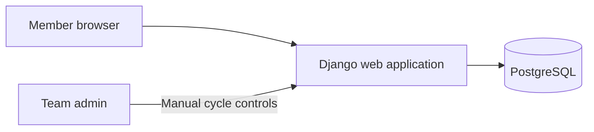

# Architecture

## Goals and scope

The MVP is a single-team web application for weekly Start / Stop / Continue feedback and retrospectives. It uses Django with server-rendered templates and PostgreSQL for persistent data. PostgreSQL runs locally through Docker Compose. The admin controls cycle start, retrospective opening, and closure manually. The browser uses standard HTML and CSS, with small amounts of plain JavaScript only where useful. Recurring schedules, automatic cycle transitions, Celery, email invitations, notifications, and action-item tracking are outside the MVP.

## System overview

Django owns request handling, authentication, validation, authorization, cycle controls, and HTML rendering. PostgreSQL is the source of truth for membership, cycles, and feedback. The administrator creates member accounts, which are immediately confirmed and usable without invitation emails. Docker Compose provides PostgreSQL for local development. A future post-MVP iteration may add recurring schedule data, Celery scheduling, and email invitations.

## Django responsibilities

Organize the application around team setup and membership, cycle lifecycle, and feedback. Use Django forms for input validation and templates for pages. Keep business rules in reusable service functions called by views. Every read and write must enforce authorization on the server; hiding a button or template section is not an access control.

## Core data model

- **User:** Django account used for login and feedback authorship.
- **Team:** The single installation team, including its name.
- **Membership:** Links a user to the team with either `admin` or `member` role and an active/removed state. Enforce one membership per user and at most one active administrator.
- **Cycle:** One manually controlled feedback period with timezone-aware `started_at`, `retrospective_opened_at`, and `closed_at` timestamps plus a state. Enforce one active cycle per team.
- **Feedback:** One entry per member per cycle, containing `start_text`, `stop_text`, and `continue_text`. Enforce uniqueness on `(cycle, author)` and require at least one non-empty field in application validation.

The one-team rule should be enforced in application setup and protected with database constraints where practical. Membership removal must revoke access without deleting feedback authorship from archived records.

## Weekly cycle lifecycle

The MVP has no recurring schedule settings. The admin starts each cycle and explicitly opens its retrospective and closes it. Store lifecycle timestamps as timezone-aware instants. A cycle moves through `open`, `retrospective`, and `closed`; enforce valid transitions and allow only one active cycle at a time. Recurring local times, timezone rules, and daylight-saving behavior are post-MVP concerns.

The MVP does not run Celery or a background scheduler. Admin actions perform the cycle transitions. Authorization and feedback writes must check the persisted cycle state on every request, so privacy and closure rules hold regardless of what the interface displays.

## Access rules

| Requester and cycle phase | Allowed access |
| --- | --- |
| Any active member before retrospective | Their own current-cycle feedback only; no other feedback or participation status |
| Member during retrospective, before own submission | Submit or edit their own feedback; no other members’ feedback |
| Member during retrospective, after own submission | Shared current-cycle board and own feedback |
| Member after cycle closure | No access to archived cycles |
| Administrator after cycle closure | Read-only access to archived cycles |
| Administrator for membership and cycle controls | Create/remove member accounts and control cycle state; follows the same feedback visibility rules as a member |

Apply these rules to every view, form action, and query path. Return no submission counts or status data before retrospective activation.

## Operational boundaries

Run the Django web process against PostgreSQL. Use Docker Compose for the local database and configure secrets, database credentials, and allowed hosts through environment settings. Keep migrations and static assets in the Django deployment workflow. Add integration tests for permissions and manual cycle transitions before release. The detailed implementation backlog, including post-MVP scheduler architecture, is in `_docs/tasks.md`.
