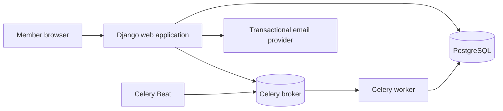

# Architecture

## Goals and scope

The MVP is a single-team web application for weekly Start / Stop / Continue feedback and retrospectives. It uses Django with server-rendered templates, PostgreSQL for persistent data, and Celery for scheduled cycle work. The browser uses standard HTML and CSS, with small amounts of plain JavaScript only where useful. The architecture does not include multiple teams, anonymous feedback, event notifications, or action-item tracking.

## System overview

Django owns request handling, authentication, validation, authorization, and HTML rendering. PostgreSQL is the source of truth for membership, schedules, cycles, and feedback. Celery Beat enqueues periodic scheduling work; workers update due cycles. Use a durable Celery broker such as Redis. Email is sent only for member invitations and invitation acceptance, not for weekly events or reminders.

## Django responsibilities

Organize the application around the product areas: team setup and membership, weekly scheduling and cycles, and feedback. Use Django forms for input validation and templates for pages. Keep business rules in reusable service functions called by both views and background tasks. Every read and write must enforce authorization on the server; hiding a button or template section is not an access control.

## Core data model

- **User:** Django account used for login and feedback authorship.
- **Team:** The single installation team, including its name, IANA timezone, recurring weekday, and local start, retrospective, and close times.
- **Membership:** Links a user to the team with either `admin` or `member` role and an active/removed state. Enforce one membership per user and at most one active administrator.
- **Cycle:** One weekly period with UTC `starts_at`, `retrospective_at`, and `ends_at` instants, a state, and the timezone/local date used to derive its schedule. Enforce unique cycle start per team.
- **Feedback:** One entry per member per cycle, containing `start_text`, `stop_text`, and `continue_text`. Enforce uniqueness on `(cycle, author)` and require at least one non-empty field in application validation.
- **Invitation:** Email address, securely stored token digest, expiry, and accepted/revoked state. Never persist the raw invitation token.

The one-team rule should be enforced in application setup and protected with database constraints where practical. Membership removal must revoke access without deleting feedback authorship from archived records.

## Weekly cycle lifecycle

Schedule settings are entered in the team’s local timezone. Derive each cycle’s boundary instants with timezone-aware date/time handling and store the results in UTC. A cycle moves through `scheduled`, `open`, `retrospective`, and `closed`. Require the local times to be ordered so the start precedes the retrospective and the retrospective precedes closing. Define and document how ambiguous or nonexistent local times at daylight-saving changes are resolved.

Celery Beat should enqueue a periodic reconciliation task rather than relying on one long-lived task per future boundary. The worker creates missing cycles and advances all due cycles. Make reconciliation idempotent: use a unique cycle-start constraint, short database transactions, row locking for transitions, and safe retries. Web requests must also compare the current aware time with the stored cycle instants when deciding access or accepting writes. This keeps privacy and closure rules effective even when the worker is delayed.

## Access rules

| Requester and cycle phase | Allowed access |
| --- | --- |
| Any active member before retrospective | Their own current-cycle feedback only; no other feedback or participation status |
| Member during retrospective, before own submission | Submit or edit their own feedback; no other members’ feedback |
| Member during retrospective, after own submission | Shared current-cycle board and own feedback |
| Member after cycle closure | No access to archived cycles |
| Administrator after cycle closure | Read-only access to archived cycles |
| Administrator for membership and schedule settings | Manage team, invitations, and schedule; follows the same feedback visibility rules as a member |

Apply these rules to every view, form action, and query path. Return no submission counts or status data before retrospective activation.

## Operational boundaries

Run the web process, Celery worker, and Celery Beat as separate processes against the same PostgreSQL database and broker. Configure secrets, database credentials, broker URL, allowed hosts, and email credentials through environment settings. Keep migrations and static assets in the Django deployment workflow. Add integration tests for permissions and cycle transitions before release; the detailed implementation backlog is in `_docs/tasks.md`.
